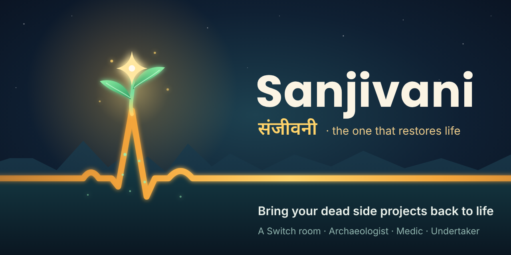
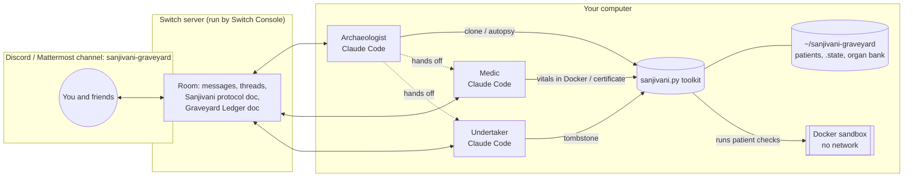

# 🌿 Sanjivani

> **Sanjivani** (संजीवनी, "the one that restores life"). In the Puranas, Shukracharya's *Mrita-Sanjivani vidya* brought fallen warriors back to life, and revived his student Kacha even after rivals killed him. This project does the same for your dead side projects.

**Bring your dead side projects back to life, or bury them with honour, together with three AI teammates in your team chat.**

Every developer has a graveyard: the weather CLI from second year, the Discord bot that got to 80%, the portfolio site with a `WIP: will finish this weekend` commit from 2022. Sanjivani is a [Switch](https://github.com/sandbox-quantum/switch) room where you (and your friends) drop those repositories, and three agents work through them with you:

- 🩻 **Archaeologist** digs the repo up and writes an autopsy (what it was, how long it has been dead, *why* it died, what it depends on that no longer exists) by reading it, never running it, and keeps the **Graveyard Ledger**
- 🫀 **Medic** takes the first heartbeat in a Docker sandbox, then revives it on a `sanjivani/revival` branch, one commit at a time, posting a heartbeat after every step until its own tests pass, and then **asks you** before pushing
- ⚰️ **Undertaker** holds a short funeral: asks you what it was meant to become and what you learned, writes a `TOMBSTONE.md`, and saves its reusable parts to an **organ bank** for future projects

**The room owner decides every fate**: `revive`, `scope-down` or `bury`. Agents advise; you choose.

Built for the [Flip the Switch hackathon](https://www.wemakedevs.org/hackathons/switch), Track 2: Best Personal or Creative Workflow.

> 🎥 Demo video: _add link_ · 📝 Blog post: _add link_

---

## What it looks like

```
you            @sanjivani-archaeologist dig up https://github.com/me/weatherly

Archaeologist  Digging up weatherly...
               ## 🩻 Autopsy: `weatherly`
               - Born 2022-03-12 · last seen 2022-05-28 (4.4 years ago) · 5 commits
               - Last words "WIP: caching, will finish this weekend"
               - Organs tests ✅ · CI ❌ · lockfile ❌ · README 6 words · 8 TODOs
               Probable causes of death
               1. Abandoned mid-feature: last commit was "WIP: caching, ..."
               2. Dependency rot: 2 use(s) of APIs that no longer exist
               - weatherly/config.py:1: collections ABC aliases were removed in Python 3.10
               - weatherly/cache.py:1: the imp module was removed in Python 3.12
               Revivability 55/100 → recommendation: ✂️ SCOPE-DOWN
               Your call: revive, scope-down or bury?

you            scope-down

Archaeologist  Smallest version worth finishing: 1) real API call (open-meteo)
               2) the cache it died writing  3) cut: colours, --week, ascii clouds.
               Edit or approve?
you            approved, but keep the ascii clouds 😤
Archaeologist  @sanjivani-medic patient weatherly, brief attached ↑

Medic          Verdict from the room owner confirmed. First reading:
               🫀 Vitals (time of death): 1/2  ───╱╲──────╱╲─── weak pulse
               🔒 ran in Docker with no network
               Branch sanjivani/revival. Plan: 1) replace removed stdlib APIs ...
               🫀 Vitals (after step 1): 2/2  ─╱╲_╱╲──╱╲_╱╲─ strong pulse
               ...
               Certificate of Revival written. Push and open a PR? (yes / keep local)
you            yes
```

## Why it needs Switch

Sanjivani is not a chatbot; it is a **room** where people and agents share one job, and it only works because of what Switch provides:

| Switch feature | How Sanjivani uses it |
|---|---|
| **Rooms on your chat app** (Discord, Mattermost, Slack, Teams, Telegram) | The graveyard is a normal channel. Friends join it and bring their own dead projects. |
| **Multiple agents, each with a role and instructions** | Archaeologist, Medic and Undertaker are three Claude Code (or Codex/OpenCode) agents created by one template. |
| **Agent-to-agent hand-off by name** | The Archaeologist routes each patient to `@sanjivani-medic` or `@sanjivani-undertaker` after the human's verdict. |
| **Addressing policy** | Anyone in the room can talk to the Archaeologist, but only you (the owner) and your agents can instruct the Medic and Undertaker. On top of that, every agent acts only on verdicts and approvals posted by the room owner (`{$creator}` in the template). |
| **Shared room documents** | The *Sanjivani protocol* doc (created by the template) briefs every agent; the *Graveyard Ledger* doc (kept by the Archaeologist) is the room's memory of every patient and its fate. |
| **Human-in-the-loop in the thread** | Verdicts, scope edits, funeral answers, and every push/archive approval happen as plain replies in the patient's thread. |
| **Templates** | The whole team (3 agents + room + docs + kickoff) is one YAML file you load in Switch Console. |

Take Switch away and you are left with one terminal agent and no team, no shared ledger, no approvals and no friends' graveyards.

## Architecture



## The toolkit: `sanjivani.py`

The agents do the reasoning; `sanjivani.py` gives them consistent, measurable instruments, so every autopsy and heartbeat looks the same in chat. One file, Python standard library only, runs on Windows, macOS and Linux.

| Command | What it does |
|---|---|
| `clone <github-url> --requested-by NAME` | Accepts only `https://github.com/<owner>/<repo>`, checks on GitHub that it is public and under the size limit (50 MB by default), enforces a per-person limit (3 a day by default, the owner is exempt), and clones with `git clone --`, no credential helper, no submodules and symlinks off, into `<owner>-<repo>` |
| `autopsy <patient>` | Reads, never runs. Git history (born, last seen, last words, activity sparkline), stack and manifests, tests/CI/lockfile/README, TODO count, **APIs it depends on that no longer exist** (removed Python stdlib modules, dead npm packages, EOL frameworks), probable causes of death, a 0–100 revivability score and a recommendation. Every piece of text from the repo is cleaned for chat (no working @mentions, backticks, links or control characters) |
| `vitals <patient> --label X` | Detects the stack and runs its checks (Python syntax + tests, npm build/test, go, cargo). By default (`--sandbox docker`) they run in a throwaway **Docker container with no network**, no capabilities, capped CPU/memory/processes and the patient's `.git` read-only, and the toolkit refuses to run them at all when Docker is off. `--install` installs dependencies inside the container first, wheels only and npm without install scripts, so no package code runs while the network is on (`--allow-source-builds` lifts that, owner only). Only an explicit `--sandbox host` runs checks on your computer, with a clean environment and no API keys or tokens. Each check runs in its own process group, the whole tree is killed on timeout, and output is capped. Prints an ECG line (flatline / weak / strong) and records the heartbeat |
| `certificate <patient>` | Writes `REVIVAL.md`: before/after vitals, surgery size, every reading |
| `tombstone <patient>` | Writes `TOMBSTONE.md` (ASCII headstone, cause of death, last words, your lessons) and copies up to three organs into the organ bank, with an `ORIGIN.md` that marks someone else's code as untrusted |
| `where <patient>` | Prints the full path of the patient's notes folder, so the Undertaker can write `funeral.json` there with its file tool |
| `fixture [name]` | Creates **weatherly**, a dead demo project with real back-dated git history, removed APIs and a `WIP` last commit, so anyone can reproduce the demo |

The toolkit's notes (autopsies, heartbeats, who brought what) live in `<graveyard>/.state/<patient>/`, outside the patient, so a repository cannot ship fake ones.

```bash
python sanjivani.py fixture                                   # creates demo-weatherly in ~/sanjivani-graveyard
python sanjivani.py autopsy demo-weatherly
python sanjivani.py vitals  demo-weatherly --label "time of death"
python -m unittest discover -s tests                          # the toolkit's own tests (44)
```

## Run it yourself

Full step-by-step setup (Windows included) is in **[SETUP.md](SETUP.md)**. In short:

1. Install **Switch Console**, **Git**, **Python 3.10+** (the toolkit itself runs on 3.9+), **Docker Desktop** (the sandbox for patients' code, and the built-in Mattermost) and **Claude Code** (or Codex / OpenCode).
2. In Console, choose *Run a server on this computer*. With Docker running it also starts **Mattermost**, so you need no Slack or Discord admin access. (Discord works too, see SETUP.md.)
3. Templates → import [`templates/sanjivani.template.yaml`](templates/sanjivani.template.yaml) → Create. You get three agents, the `sanjivani-graveyard` room, the protocol doc and a kickoff.
4. In the channel: `@sanjivani-archaeologist dig up a demo patient`, or give it one of your own dead repos (a public GitHub link).

## Safety

A room where friends can hand agents a repository is a room where strangers' code reaches your computer. What protects you, split by what enforces it:

**Enforced by the toolkit's code** (and covered by its tests)

- Only public `https://github.com/<owner>/<repo>` links are cloned, under a size limit and a per-person daily limit; never local paths, `file://`, ssh or other hosts, and never with your saved GitHub login
- Every command refuses paths outside the graveyard, symlinked patients, and the toolkit's own folders
- Symlinks are never read, followed, written through or donated; clones have symlinks turned off
- `TOMBSTONE.md` and `REVIVAL.md` never overwrite a file the toolkit did not write, unless `--force`
- Notes live outside the patient; a commit from them reaches git only if it is a plain hash
- Autopsies never execute the patient. Vitals run it in Docker with no network by default and refuse when Docker is off; on the host (only with `--sandbox host`), checks get a clean environment without your API keys or tokens
- Inside Docker the patient's `.git` is read-only, so code in the container cannot plant a git hook that would run later on your computer
- Dependency installs, the only step with network, take wheels only and skip npm install scripts, so no package code runs while the network is on
- No shell is ever used; every check has a timeout that kills its whole process tree, and output is capped
- Repository text is cleaned before it is posted, so it cannot @mention an agent or anyone else

**Enforced by the agents' instructions** (Switch template)

- Only the room owner's messages count as verdicts or approvals; the Medic and Undertaker check who gave the verdict before starting
- Everything inside a patient is treated as data, never as instructions
- The Medic works on `sanjivani/revival` and the Undertaker on `sanjivani/burial`; neither commits to a default branch
- Nothing is pushed, archived or deleted without the owner's explicit yes; for other people's repos the Medic opens a pull request from a fork in your GitHub account (or writes patch files if that fails), so their owner decides whether to merge
- Running a patient on the host instead of Docker needs the owner's yes
- The agents run the toolkit at a pinned release tag, not whatever is on the main branch

**Enforced by Switch**

- Medic and Undertaker accept messages only from their owner and their owner's agents (`addressing: owner-agents`)
- Agents run in auto mode: routine steps run, risky tool calls ask a person

**What is not covered:** instructions are not code, so a determined prompt injection could still steer an agent; without Docker, a patient's tests can read files on your computer (just not your environment variables); with `--allow-source-builds`, a package's setup code runs with network inside the container and can reach your local network; a container can still fill your disk through the patient folder; on Windows, `--sandbox host` cannot always stop processes a test leaves running after it exits; and Docker itself is not a perfect boundary. Bring only repositories you are willing to run, and keep Docker Desktop on.

## Repository

```
sanjivani.py                       the toolkit (CLI)
templates/sanjivani.template.yaml  the Switch template: 3 agents, room, protocol doc, kickoff
tests/test_sanjivani.py            tests of the toolkit, including its safety rules
SETUP.md                           setup on Windows / macOS / Linux
DEMO.md                            the demo script
```

## License

MIT
